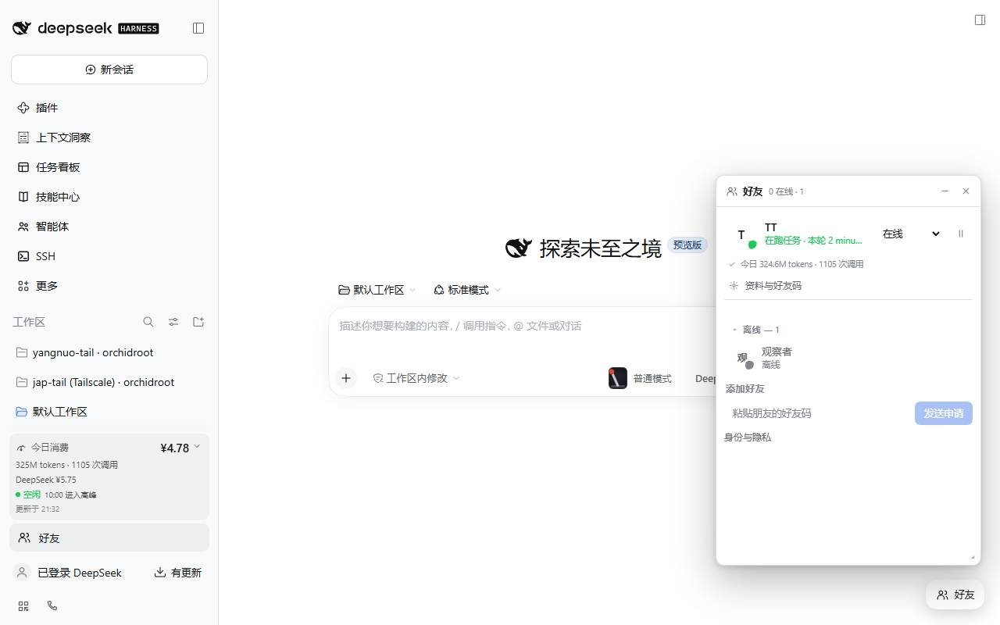
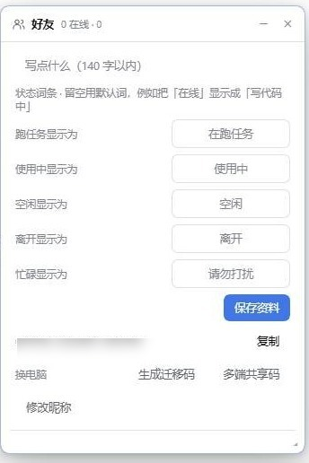

# DSH Friends · 好友浮窗、聊天与个人资料 0.8.1

Steam 风格的 **DSH 原生插件 + 可自部署好友服务**，不是 Steam 接口。新增 DSH 内可拖动、缩放、最小化的好友浮窗和多标签聊天窗口；它们不是独立系统窗口。

> **先选一台服务。** 插件默认连本机 `http://127.0.0.1:8787`，那是给"服务跑在自己电脑上"用的；不改成别人的地址，你永远看不到别人的好友。
>
> - **想直接用**：用下面的公共体验实例，把插件 `serviceUrl` 改成 `https://friends.150-109-84-45.nip.io`，重启 DSH。这是台个人服务器上的**临时实例**，无 SLA、随时可能下线、管理员能读到聊天明文 —— 先读 [公共体验实例说明](./PUBLIC-INSTANCE.md)。
> - **想自己掌控**：按下方「快速启动服务」在本机或 VPS 上起一份，`serviceUrl` 指向它；好友也要填同一个地址。

## 界面





好友浮窗贴右下角，可拖动、缩放、最小化；「资料与好友码」里可以换头像、写签名、改状态词条和出迁移码。

## 快速开始

### 加入公共体验实例

1. 安装插件（见 [安装插件](#安装插件)）
2. 插件配置里把 `serviceUrl` 改成 `https://friends.150-109-84-45.nip.io`
3. 重启 DSH，打开好友浮窗 → 创建身份 → 拿到好友码 → 和朋友互相添加

细节、免责和隐私提醒见 [PUBLIC-INSTANCE.md](./PUBLIC-INSTANCE.md)。

### 自建服务

```sh
npm start            # 需要 Node 24+；默认 127.0.0.1:8787
```

然后用 Caddy / nginx 终止 TLS 并反代（见 [部署](#部署与限制)），把 `serviceUrl` 指向你的 `https://` 域名。

## 使用

侧栏底部的「好友」行、或右下角「好友」按钮，都会直接在当前位置弹出浮窗，**不会切换 DSH 页面**。标题栏拖动，右下角 ◢ 缩放，可最小化；切换 DSH 会话不影响，重新加载页面重置布局。点击好友的聊天按钮；Enter 发送，Shift+Enter 换行，输入法选字不误发送。

**个人资料**：上传头像（客户端压成 96px JPEG，好友按需拉取，不进轮询快照）、140 字签名，以及自定义**状态词条**（把「在线」显示成「写代码中」）。

**换电脑 / 多端**：旧机器在「资料与好友码 → 换电脑」里出码，新机器在欢迎页「换电脑」里输入。两种模式：

- **迁移码**：认领时服务端换发新令牌，旧机器立即退出登录（真正搬家）。
- **多端共享码**：服务端只存一份用码派生的 AES-GCM 密文，认领后两台持有同一个令牌、同时在线；代价是两台权限完全相同，不能单独撤销其中一台。

两者都是 8 位、10 分钟有效、只能用一次；共享码认领后立即删除，数据库里没有可复用的令牌。

**活动状态与用量**：插件根据 DSH 是否正在写会话日志判断「在跑任务」，并区分「使用中 / 空闲」，三者都能自定义词条。浮窗里还会显示今日 token 用量和调用次数（读 DSH 自己的用量账本，不读对话内容）；本轮任务的耗时在跑任务时实时计时。

一对一聊天支持离线留言、历史分页、未读数、新消息提醒及已读回执。每条最多 2000 个 Unicode 字符，每段会话保留最近 1000 条。失败保留草稿，由用户手动重试，同一次重试携带相同 clientId 避免重复。

**删除好友永久清除双方聊天。** 界面上没有「注销账号 / 忘记身份」入口（需要时可直接调服务端 API）；令牌没有找回机制，换机器请用下面的迁移码。

保留好友码申请/确认、拒绝/撤回、昵称搜索、在线/离开/忙碌/隐身、签名、最后在线、自动离开和上线提醒。令牌存于 DSH 凭据库，不发给浏览器，不读取 DSH 会话、文件、模型或任务。

## 隐私

聊天明文存于自部署服务器的 SQLite，管理员可读取，**不是端到端加密**。只有已确认好友可访问双方会话，第三位好友不能收取消息事件或读取历史。已读仅在聊天活动、页面可见且有焦点、入站消息实际显示在聊天视口时提交。

隐身只隐藏在线状态和签名，**主动发送消息或已读回执仍可能透露活动**。

## 启动服务

需要 Node.js **24+**，无 npm 依赖：

```sh
npm start
```

默认只监听 `http://127.0.0.1:8787`，数据在 `./data`。SQLite experimental warning 不代表失败。**服务只提供 API，没有网页界面**（早期版本自带过一个只支持好友/状态的网页，已移除）；除 `/api/*` 与 `/healthz` 之外的路径一律返回 404 JSON。所有界面都在 DSH 插件里。

0.2.x 数据库自动加表/列，身份和好友保留。升级前停服务，备份整个 DATA_DIR。0.1.x 曾使用浏览器身份，不能自动迁移到 DSH 凭据库。

## 安装插件

安装 `plugin` 目录或 `dsh-friends-plugin-0.8.1.tgz`，不要安装项目根目录（它是服务端）。确认 Host 信任提示；插件在 DSH 进程内运行。目标 DSH `>=0.2.1-rc.5 <0.3.0`，使用自带 Schema 与 React，无前端构建步骤。

serviceUrl 默认 `http://127.0.0.1:8787`，指 Host 所在机器可访问的服务 origin。改成别人的服务就填对方的 HTTPS 域名；改完必须重启 DSH 才生效（在 DSH「插件」页编辑，或改 profile 的 `cordis.patch.yml`）。远程必须 HTTPS，禁止路径、query、账号密码、跳转。autoAwayMinutes 默认 10，0 关闭自动离开。

升级后按 DSH 提示刷新或重启。**磁盘版本不代表运行 Host 版本**，state RPC 的 version 应为 0.8.1。身份按服务 origin 哈希，存在 ctx.credentials grant 记录，跨端口变化/刷新/Host 重启保留；换电脑或 origin 不自动同步。**插件更新后 Host 侧代码需要重启 DSH 才生效**（只换了磁盘上的包、没重启，运行的还是旧 Host 代码）。

```sh
cd plugin
npm pack --ignore-scripts
```

## 实时链路与权限

浏览器调用 owner 鉴权的 `/api/dsh-friends.rpc` 固定操作表，不能指定上游路径或获取令牌。Host 15 秒心跳，SSE 接收好友/消息变化，浏览器通过最多 20 秒的可取消长轮询即时更新；SSE 断线退避重连，保留 5 秒/60 秒快照轮询兜底，事件缺口用历史游标补取。

聊天 API：`GET/POST /api/chats/:friendId` 和 `POST /api/chats/:friendId/read`，历史支持 before/after id 分页。写事务内再次检查好友关系，防止慢上传时权限已被撤销；旧 HTTP 响应不得覆盖新的 SSE/本地消息状态。服务端只存令牌摘要，不开放 CORS，不应公开 DSH 管理端口。

## 部署与限制

```sh
docker compose up -d --build
```

[Compose](compose.yaml) 仅发布回环端口，非 root 容器与命名数据卷。公网用 Caddy/nginx HTTPS 反代至服务端，设置 PUBLIC_ORIGIN 与每人的 serviceUrl 为同一 HTTPS origin，可用 SIGNUP_CODE 限制注册。未设置开机自启或公网暴露。

环境变量：HOST（127.0.0.1）、PORT（8787）、DATA_DIR（./data）、PUBLIC_ORIGIN、SIGNUP_CODE、REGISTER_LIMIT_HOUR（100）、IP_LIMIT_MINUTE（10000）、IDENTITY_LIMIT_MINUTE（300）。默认每身份每分钟 60 条聊天；最多 500 好友、100 待处理申请、20 租约和 5 条 SSE。全服最多 10000 身份，单进程 SQLite，不支持多实例共享在线状态。不信任 X-Forwarded-For，反代用户共享出口 IP 额度。

多设备状态取在线 > 忙碌 > 离开，隐藏设备不覆盖可见设备。隐身活动不更新最后在线。卸载尽力释放租约，失败时约 45 秒自然离线；凭据保留可重装继续使用。

## 验证与备份

```sh
npm test
npm run check
```

当前 85 项自动化测试通过，包括真实服务与双 Host 实时聊天、好友撤销和慢请求竞态、幂等重试、未读乱序、长轮询取消及已有隐私/身份回归。其中浮窗事件测试使用轻量 React stub（不是 DOM 视觉验收）。已在当前 DSH 实测：侧栏点开即浮窗（不切页面）、拖动/缩放/最小化、实时收发、未读徽标与提醒、已读回执、刷新后历史恢复、头像与状态词条、多端共享码，均经真实浏览器核对；DSH 重启后 Host 代码更新也已验证。公网部署（Docker + nginx + certbot）已在一台 Ubuntu 24.04 上跑通注册、加好友、发消息、SSE 与迁移码。项目自带的 Dockerfile 与 compose 配置尚未实际构建（线上实例是直接用 `node:24-alpine` 镜像跑 `server/main.mjs`）。

备份前停服务，备份整个 DATA_DIR；数据库包含本插件聊天，不包含 DSH 会话。源码 ZIP 排除数据库、凭据和 node_modules。

许可：[MIT](./LICENSE) · 安全策略与威胁模型：[SECURITY.md](./SECURITY.md) · 公共实例条款：[PUBLIC-INSTANCE.md](./PUBLIC-INSTANCE.md)

源码：[服务端](server/service.mjs) · [Host](plugin/host.mjs) · [聊天缓冲](plugin/chat.mjs) · [实时订阅](plugin/stream.mjs) · [界面](plugin/client.js) · [插件说明](plugin/README.md)。
